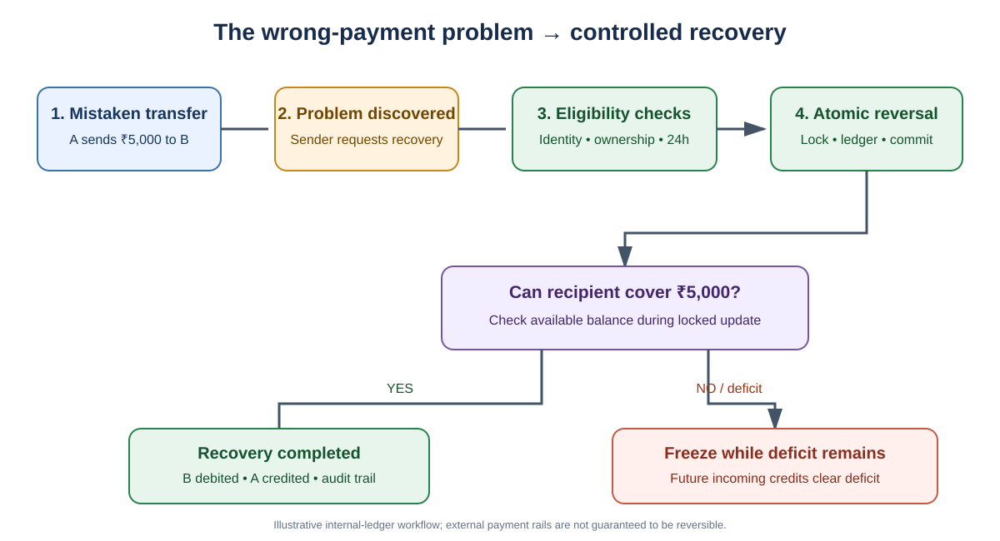
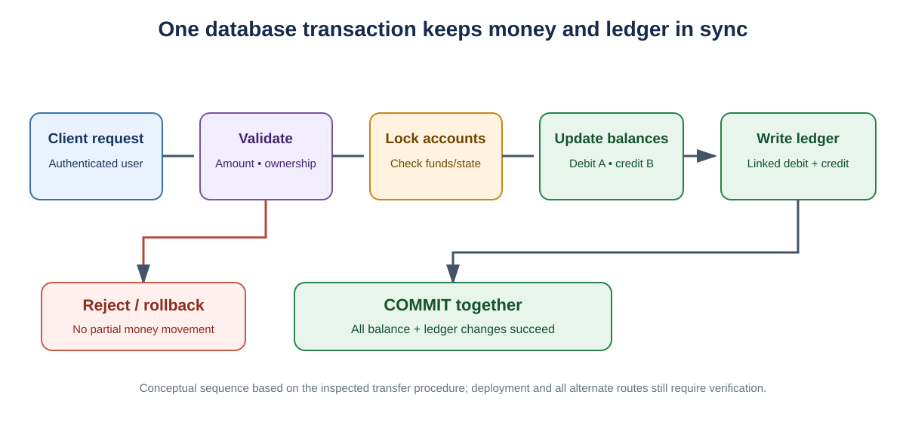
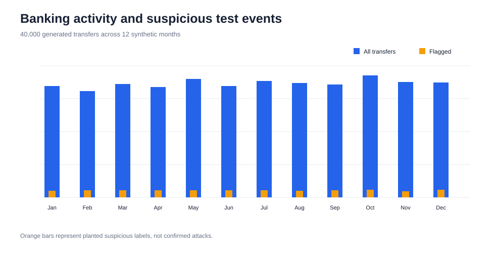
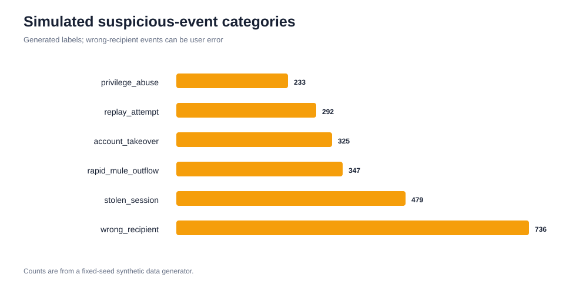
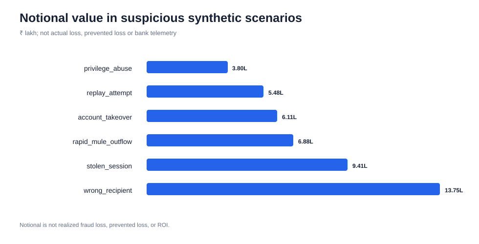
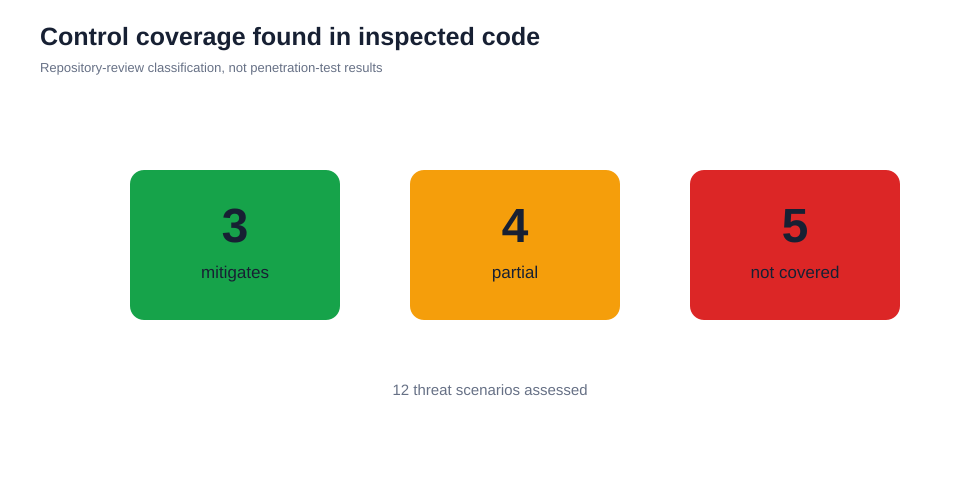
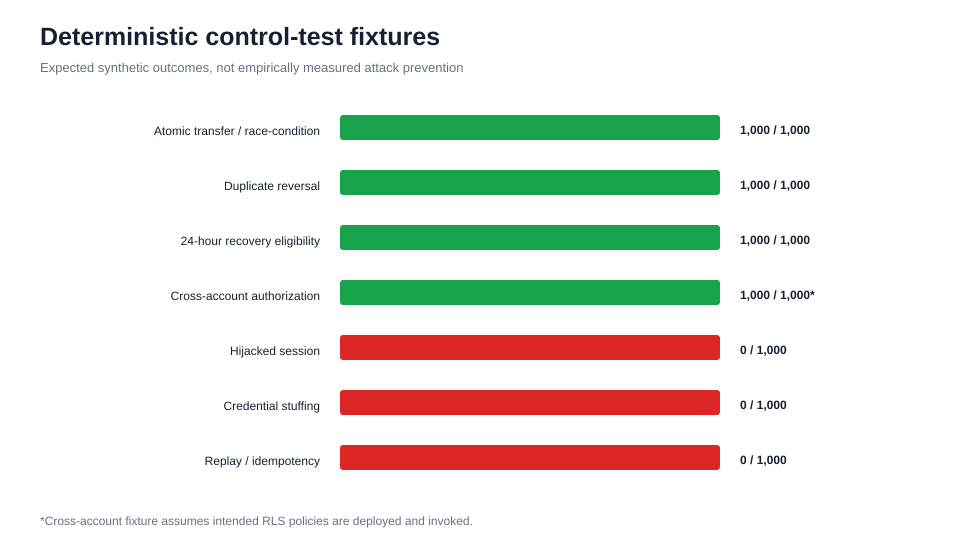
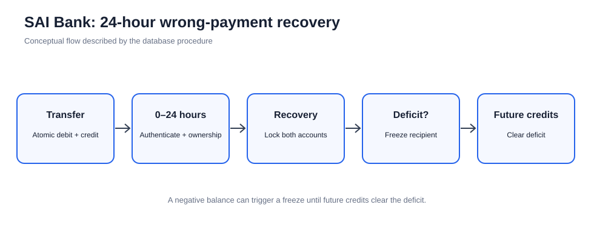

# SAI Bank — 24-Hour Wrong-Payment Recovery & Transaction Security

**A business-problem and security case study** based on the SAI Bank demonstration application: [github.com/pallasivasai/saibank](https://github.com/pallasivasai/saibank).

This project explains a real banking problem in plain language, shows how SAI Bank's database-level workflow is designed to address it, reviews the code evidence, and analyses reproducible synthetic transaction scenarios.

> **Important:** SAI Bank is a demonstration application, not a production bank. The statistics below come from a generated synthetic dataset and code-review mapping. They are not real customer activity, confirmed fraud, money recovered, or measured attack-prevention rates.

---

## 1. What problem are we solving?

A customer sends money to the wrong person, or an unauthorized/incorrect transfer is discovered after it has completed. In an ordinary completed transfer, the sender's balance has already decreased and the recipient's balance has increased.

The difficult situation is when the recipient has already spent the money. Simply adding the amount back to the sender would create money that is not backed by the recipient's balance. A careless implementation can also create duplicate reversals, mismatched balances, or ledger records that do not agree.

**Business impact**
- Customers may lose access to money while a dispute is investigated.
- Support teams need to investigate and reconcile transactions manually.
- A duplicate or partially completed reversal can create financial and audit inconsistencies.
- If the recipient has already spent the funds, recovery becomes more complicated.

**SAI Bank's specific question:** Can a customer-requested recovery workflow, available for up to 24 hours after an eligible transfer, safely create compensating ledger entries while preserving account and transaction integrity?

## 2. How the SAI Bank solution works

The 24-hour window is a recovery-request window, not a promise that every payment can be recovered. The procedure still checks identity, ownership, transaction type, previous reversal status and account state.



### Step-by-step example

Assume A sends ₹5,000 to B by mistake.

1. **Original transfer:** the database transaction debits A by ₹5,000 and credits B by ₹5,000. Linked ledger entries record both sides.
2. **Recovery request:** A requests reversal within 24 hours.
3. **Eligibility checks:** the procedure verifies the authenticated caller, that the original debit belongs to A, that it is eligible, and that it has not already been reversed.
4. **Safe account updates:** the database locks the relevant account rows, applies the compensating debit/credit entries, and marks the original transaction as reversed.
5. **If B still has enough money:** B's balance is debited and A's balance is credited.
6. **If B has already spent some or all of it:** the recovery can leave B with a negative balance. The account is frozen while the deficit remains; future incoming credits can reduce the deficit and clear the freeze when the balance is restored.

The recovery workflow does **not** guarantee that money can be retrieved from an external bank, UPI rail, or payment provider. It describes the controls implemented inside this application's own ledger.

## 3. Why database-level processing matters

Money movement must be treated as one indivisible database operation. If a system updates the sender, then fails before updating the recipient or writing the ledger, its records can disagree.



SAI Bank's inspected `transfer_money()` database function performs authentication checks, validation, account-row locking, balance changes and linked debit/credit ledger writes inside one database function/transaction. The inspected `reverse_transaction()` procedure applies eligibility checks and compensating entries under account locks.

This design is only protective when **every** money-changing route uses the guarded database procedures. The repository also contains a legacy Edge Function that appears to make balance and ledger changes as separate requests; if that path is still reachable, it should be retired or refactored to call the atomic procedure.

## 4. What the repository review found

| Area | Evidence in inspected code | Assessment |
|---|---|---|
| Concurrent spending | Account row locks and balance validation in transfer procedure | Mitigates the tested race scenario if all paths use it |
| Wrong-payment recovery | 24-hour eligibility checks and compensating ledger entries | Recovery path; not an attack detector |
| Duplicate reversal | Reversal markers and prior-reversal checks | Mitigates the named scenario; concurrent idempotency still needs testing |
| Recipient already spent funds | Negative-balance freeze and future-credit clearing | Mitigates internal ledger deficit; cannot pull funds from external rails |
| Cross-account data access | RLS and ownership checks | Partial; all grants, policies and privileged functions need audit |
| Account takeover, phishing, API abuse | No dedicated controls evidenced in inspected application files | Important gaps to address |

**Not evidenced in the inspected files** does not prove a control is absent from every deployment layer. This is a scoped repository review, not a penetration test or production audit.

## 5. Updated SAI Bank synthetic statistics

The charts below are generated from the SAI Bank case-study dataset using a fixed random seed. They replace the unrelated ShopKart revenue/profit story as the main README content.

<details>
<summary><strong>Dataset snapshot (synthetic only)</strong></summary>

| Metric | Generated result |
|---|---:|
| Synthetic transfers | 40,000 |
| Synthetic account identifiers | 2,500 |
| Planted suspicious-event labels | 2,412 (6.03%) |
| Notional amount attached to those labelled events | ₹45.43 lakh |
| Scenarios mapped as mitigated by an evidenced control | 3 |
| Partial coverage / review required | 4 |
| No specific control evidenced in inspected code | 5 |
| Deterministic control-test fixture cases | 7 |

The ₹45.43 lakh figure is **simulated transaction notional**, not actual fraud loss, money recovered, loss avoided, or return on investment. The 3/4/5 figures count scenario mappings, not the percentage of attacks stopped.

</details>

### 5.1 Synthetic transfer activity


### 5.2 Planted suspicious-event categories


### 5.3 Simulated transaction notional


### 5.4 Evidence-based control coverage


### 5.5 Deterministic control-test fixtures


### 5.6 24-hour recovery lifecycle


## 6. What should be improved next?

1. Route every transfer and reversal through the same atomic database procedures; remove or refactor the legacy multi-request money-movement path.
2. Review RLS policies, table grants, `SECURITY DEFINER` ownership, fixed `search_path` and function execute permissions.
3. Add and test idempotency keys, deterministic lock ordering and deadlock retry behaviour.
4. Add MFA/passkeys, rate limiting, device/session risk signals, customer alerts and session revocation.
5. Add scam warnings, beneficiary cooling-off for risky transfers, centralized audit monitoring and independent penetration testing.

## 7. Reproduce the analysis

From this repository:

```bash
python -m pip install -r case-studies/sai-bank-security/requirements.txt
python case-studies/sai-bank-security/src/generate_data.py
python case-studies/sai-bank-security/src/analyze.py
python case-studies/sai-bank-security/src/render_svg_charts.py
```

The scripts regenerate the synthetic data, result tables and chart files with a fixed seed. See the [full case study](case-studies/sai-bank-security/README.md) for methodology, scenario-level results, assumptions, limitations and recommendations.

## 8. Project links

- [SAI Bank source repository](https://github.com/pallasivasai/saibank)
- [SAI Bank demo](https://saibank.lovable.app/)
- [Full SAI Bank case study and scripts](case-studies/sai-bank-security/README.md)
- [SAI Bank chart assets](case-studies/sai-bank-security/images/)

**Bottom line:** SAI Bank demonstrates a database-level pattern for safer transfers and a bounded wrong-payment recovery workflow. It addresses specific transaction-integrity and remediation risks; it is not a complete cyber-security solution and does not claim to stop most cyberattacks.
