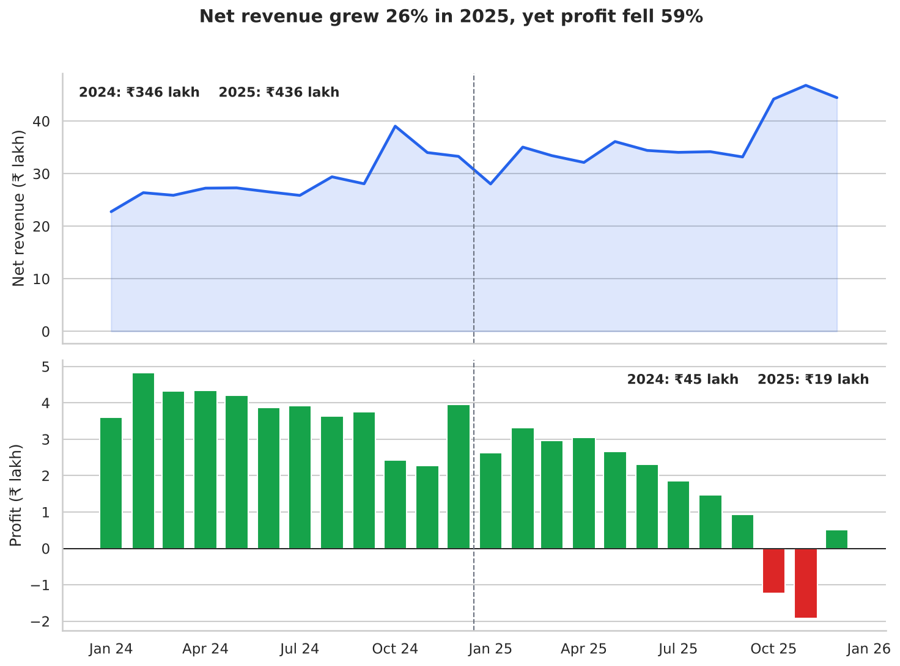
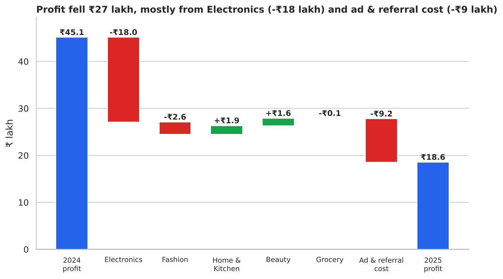
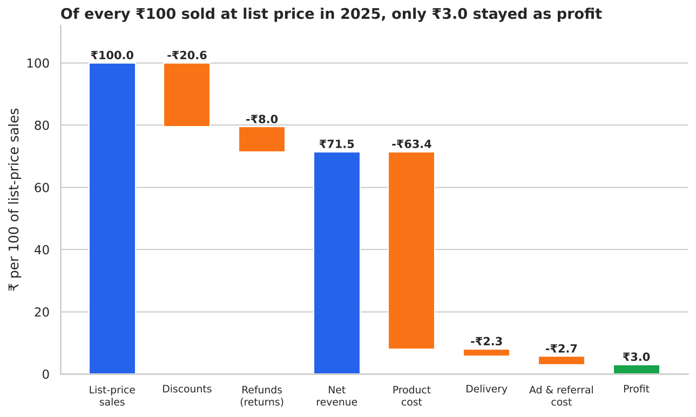
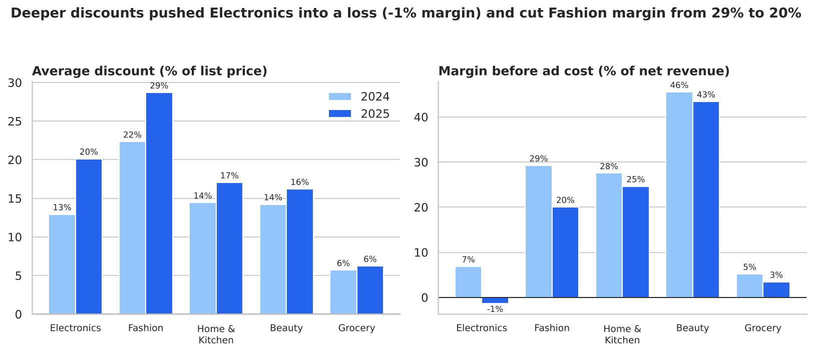
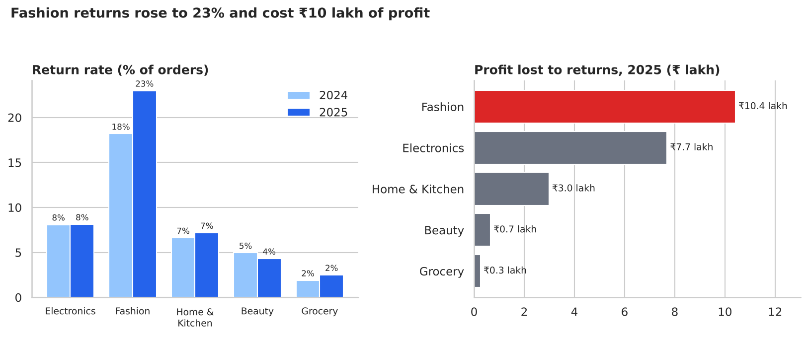
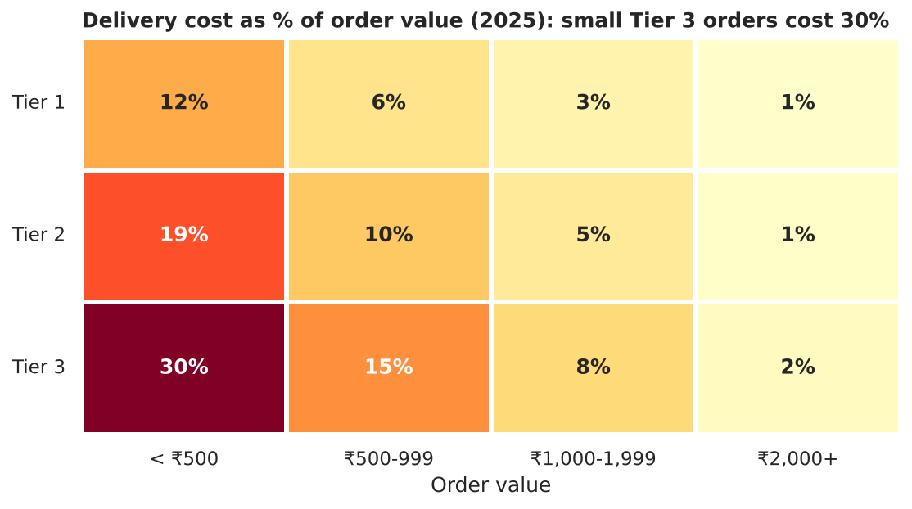
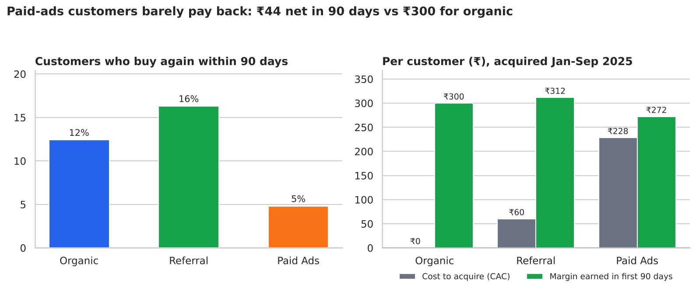
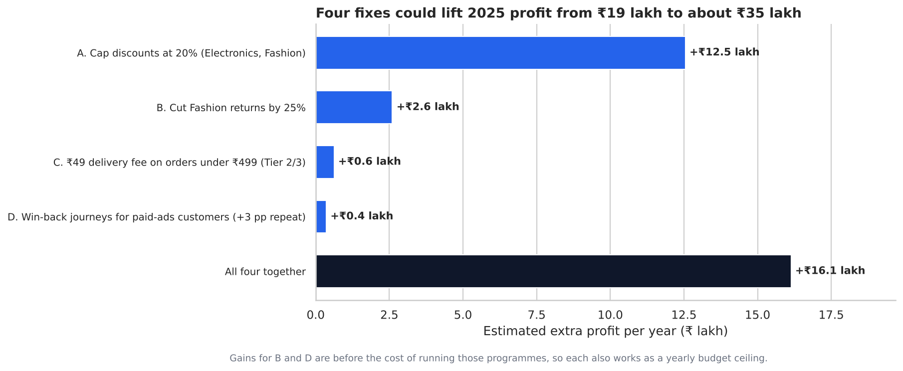

# Why Did Profit Fall 59% While Revenue Grew 26%?

A business-analytics case study in Python (pandas, matplotlib, seaborn): find where an online store's profit is leaking, and work out what fixing it is worth.

> **Note:** ShopKart Lite is a fictional company and the data is **synthetic**. It is generated by [`src/generate_data.py`](src/generate_data.py) with a fixed random seed, so every result here can be reproduced. The point of the project is the method (the questions asked, how profit is measured, how the fixes are sized), not the specific numbers.

---

## 1. The business problem

ShopKart Lite is an Indian online store selling Electronics, Fashion, Home & Kitchen, Beauty and Grocery. The founder's complaint: *"Orders keep growing and we are busier than ever, but there is hardly any money left at the end of the year."*

| | 2024 | 2025 | Change |
|---|---:|---:|---:|
| Orders | 13,030 | 17,571 | +35% |
| Net revenue | ₹346 lakh | ₹436 lakh | **+26%** |
| Profit | ₹45.1 lakh | ₹18.6 lakh | **-59%** |
| Profit margin | 13.1% | 4.3% | -8.8 pp |

**Questions to answer**

1. Where did the profit go?
2. Which leak is biggest: discounts, returns, delivery or customer acquisition?
3. What should the company change first, and what is each change worth?

**How "profit" is defined here:** net revenue (after refunds) minus product cost, delivery cost (both ways for returns) and ad/referral cost to acquire customers. Salaries, rent and technology costs are not in the data, so this is a *contribution-style* profit, not an accounting profit.

---

## 2. Short answer

1. **Discounting is the biggest leak.** The average discount rose from 14.6% to 20.6%. Electronics went from a 6.9% margin to **-1.4%**, and 36% of Electronics orders in 2025 were sold below product cost. Electronics alone explains ₹18 lakh of the ₹27 lakh profit drop.
2. **Growth got more expensive.** Ad and referral cost more than doubled (₹7.0 lakh to ₹16.2 lakh), costing ₹9.2 lakh of profit. Paid ads supplied 59% of new customers (43% in 2024), at an average cost of ₹238 per customer (₹174 in 2024), and those customers come back far less often (5% vs 12% for organic).
3. **Fashion returns jumped** from 18% to 23% of orders and cost ₹10.4 lakh of profit.
4. **Delivery is a small problem overall** (3.3% of net revenue) but a nasty one for small orders in Tier 3 cities, where delivery eats 30% of the order value.

**Recommendation:** cap discounts first (worth about ₹12.5 lakh a year), then attack Fashion returns (up to ₹2.6 lakh), then add a small-order delivery fee and win-back journeys. Together these could lift 2025 profit from ₹18.6 lakh to roughly **₹34.7 lakh (8.0% margin)**. That is still below 2024's ₹45 lakh, so the fixes recover most, not all, of the lost ground.

---

## 3. The data

[`data/orders.csv`](data/orders.csv): 30,601 orders from 19,329 customers, January 2024 to December 2025.

| Column | Meaning |
|---|---|
| `order_id`, `order_date`, `customer_id` | Identifiers and date |
| `acquisition_channel` | How the customer first arrived: Organic, Referral or Paid Ads |
| `region`, `city_tier` | North/South/East/West and Tier 1/2/3 city |
| `category` | Electronics, Fashion, Home & Kitchen, Beauty, Grocery |
| `mrp`, `discount_pct`, `quantity`, `selling_price` | List price, discount given, units, price paid per unit (₹) |
| `unit_cost` | Product cost per unit (₹) |
| `shipping_cost` | One-way delivery cost paid by the company (₹) |
| `acquisition_cost` | Ad/referral cost, recorded on the customer's first order only (₹) |
| `returned` | 1 if the order was returned |

---

## 4. Approach

1. Build the money columns for each order (all in [`src/analysis.py`](src/analysis.py)):
   - `net_revenue` = selling price × quantity, minus the refund if the order was returned
   - `cogs` = product cost; for a returned order only 30% is lost (70% is resold)
   - `shipping_total` = delivery cost, doubled for returned orders (there and back)
   - `profit` = net revenue − cogs − shipping_total − acquisition cost
2. Compare 2024 with 2025 overall, then by category, city tier and acquisition channel.
3. Build a **profit bridge** to see which parts moved the total.
4. Size four fixes with transparent what-if calculations on the 2025 orders (assumptions listed in section 7).

---

## 5. Findings

### 5.1 Revenue kept climbing, profit kept sliding



Monthly profit trends down through 2025 and turns negative in October and November, the festive-season months when discounts are deepest and order volume is highest.

### 5.2 Where the profit went



| Source of change | Effect on profit |
|---|---:|
| Electronics | -₹18.0 lakh |
| Ad & referral cost | -₹9.2 lakh |
| Fashion | -₹2.6 lakh |
| Home & Kitchen | +₹1.9 lakh |
| Beauty | +₹1.6 lakh |
| Grocery | -₹0.1 lakh |
| **Total** | **-₹26.6 lakh** |

Figures are rounded, so the lines may not add up exactly. Two things explain the entire drop: Electronics margin collapsing, and the higher cost of acquiring customers.

### 5.3 Where each ₹100 of sales goes



Out of every ₹100 sold at list price in 2025, ₹20.6 is given away as discounts and ₹8.0 is refunded on returns. Product cost takes ₹63.4, and delivery plus ad cost take another ₹5.0, leaving ₹3.0 of profit. A small change in discounts moves profit a lot because the margin left is so thin.

### 5.4 Discounts hit hardest where margins were already thin



| Category | Avg discount 2024 → 2025 | Margin before ad cost 2024 → 2025 |
|---|---|---|
| Electronics | 12.9% → 20.1% | 6.9% → **-1.4%** |
| Fashion | 22.3% → 28.7% | 29.3% → 20.0% |
| Home & Kitchen | 14.4% → 17.1% | 27.5% → 24.6% |
| Beauty | 14.2% → 16.2% | 45.5% → 43.4% |
| Grocery | 5.7% → 6.2% | 5.2% → 3.4% |

Electronics products cost about 78% of list price, so any discount above roughly 22% means selling below cost before delivery is even counted.

### 5.5 Fashion returns are the second product-level problem



Fashion returns rose from 18.2% to 23.0% of orders. Each return costs the refund, a second delivery and a write-off on part of the stock. "Profit lost to returns" here means what a returned order would have earned if it had been kept, compared with what it actually lost. Fashion lost ₹10.4 lakh in 2025 (₹6.9 lakh in 2024).

### 5.6 Delivery cost is a small-order problem



The company pays for delivery, so a cheap order in a distant city loses most of its value to logistics. Orders under ₹500 in Tier 3 cities are only 3.9% of 2025 orders, which is why delivery is a minor lever overall. The Tier 3 share of orders did grow from 20% to 30%, so the issue will get bigger if left alone.

### 5.7 Paid-ads customers barely pay back



For customers acquired January to September 2025 (so each has a full 90-day window):

| Channel | Customers | Cost to acquire | Margin in 90 days | Net per customer | Bought again in 90 days |
|---|---:|---:|---:|---:|---:|
| Organic | 2,148 | ₹0 | ₹300 | ₹300 | 12.4% |
| Referral | 1,054 | ₹60 | ₹312 | ₹252 | 16.3% |
| Paid Ads | 4,115 | ₹228 | ₹272 | **₹44** | **4.8%** |

Over a longer 180-day window (customers acquired January to June) paid-ads customers net ₹111 against ₹361 for organic and ₹319 for referral, so the gap does not close quickly. Note that paid-ads customers still earn back more than they cost, so simply switching off paid ads is **not** supported by this data. The better lever is to make those customers return, and to shift budget toward referrals, which are cheap and repeat the most.

---

## 6. Recommendations



| # | Fix | What to do | Estimated yearly gain |
|---|---|---|---:|
| A | **Cap discounts** | Limit Electronics and Fashion to 20% off. Allow festive deals only as an exception, with a floor so nothing sells below product cost plus delivery. | **₹12.5 lakh** |
| B | **Cut Fashion returns by 25%** | Size guides, better product photos, a quality check before dispatch, tracking of return reasons. | up to ₹2.6 lakh |
| C | **Small-order delivery fee** | Charge ₹49 on orders under ₹499 in Tier 2 and Tier 3 (or raise the free-delivery threshold). | ₹0.6 lakh |
| D | **Win-back journeys for paid-ads customers** | Post-purchase WhatsApp/email flows aiming for 3 more repeat buyers per 100. | ₹0.4 lakh |
| | **All four together** | | **₹16.1 lakh** |

How to read this table:

- **A depends on how customers react to higher prices.** I assumed each percentage point of discount removed loses 1.2% of the affected orders. If customers are more price-sensitive (2.0% lost per point), the gain is ₹11.3 lakh; if less (0.6%), ₹13.5 lakh. Either way it is the largest lever by far.
- **B and D are shown before the cost of the programme**, so each number is also a **budget ceiling**: the Fashion returns programme must cost less than ₹2.6 lakh a year to pay off, and win-back journeys less than about ₹5.6 per paid customer.
- The four gains are simply added. A and B both touch Fashion, so treat the total as slightly optimistic.
- **Not modelled but worth testing:** moving some paid-ads budget into the referral programme (₹60 per customer, 16% repeat rate).

---

## 7. Assumptions and limitations

- The data is **synthetic**. Real data would be messier, and real elasticities, return reasons and acquisition costs would need to be measured, not assumed.
- Fix A assumes a fixed share of orders is lost per point of discount removed. This is the biggest assumption in the project and the one to validate first with an A/B test or a price pilot on one category.
- Fix B assumes 25% of Fashion returns become kept orders. Fix C assumes the fee is not refunded and 12% of affected orders are not placed. Fix D assumes each extra repeat customer places one order worth the average repeat-order margin (₹188).
- Customer value uses a 90-day window (180 days as a check). A longer window would raise the value of every channel.
- Only two years of data are used and the comparison is year over year, so seasonality (festive months) affects both years but is not modelled separately.
- Delivery is assumed to be fully paid by the company, and 30% of returned goods are written off. Both are simplifications.
- Fixed costs (salaries, rent, technology) are not in the data, so "profit" here is a contribution-style figure.

---

## 8. Project structure

```
.
├── README.md
├── requirements.txt
├── data/
│   └── orders.csv                 # synthetic orders (30,601 rows)
├── src/
│   ├── generate_data.py           # builds data/orders.csv (seed 42)
│   └── analysis.py                # all calculations, charts and what-if scenarios
├── images/                        # the 8 charts used in this README
└── results/
    ├── key_metrics.json           # every number quoted in this README
    ├── yearly_summary.csv
    ├── category_summary.csv
    ├── channel_economics_90d.csv
    └── scenario_impact.csv
```

## 9. How to run

```bash
pip install -r requirements.txt
python src/generate_data.py   # optional: recreates data/orders.csv
python src/analysis.py        # recreates images/ and results/
```

Built and tested with Python 3.13, pandas 3.0, NumPy 2.5, matplotlib 3.11 and seaborn 0.13. To test a different idea (for example a 15% discount cap, or a ₹29 delivery fee), change the assumptions at the top of `src/analysis.py` and re-run.

**Tools:** Python, pandas, NumPy, matplotlib, seaborn.


---

## Additional case studies

- **[SAI Bank Security & Payment Protection](case-studies/sai-bank-security/README.md)** — a reproducible synthetic-data study of database transaction integrity, 24-hour wrong-payment recovery, negative-balance freezes, control coverage, remaining cyber-risk gaps, and six generated charts.
