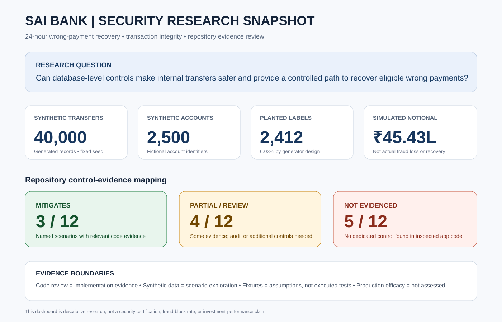
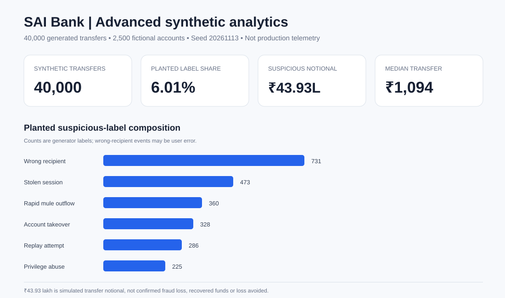
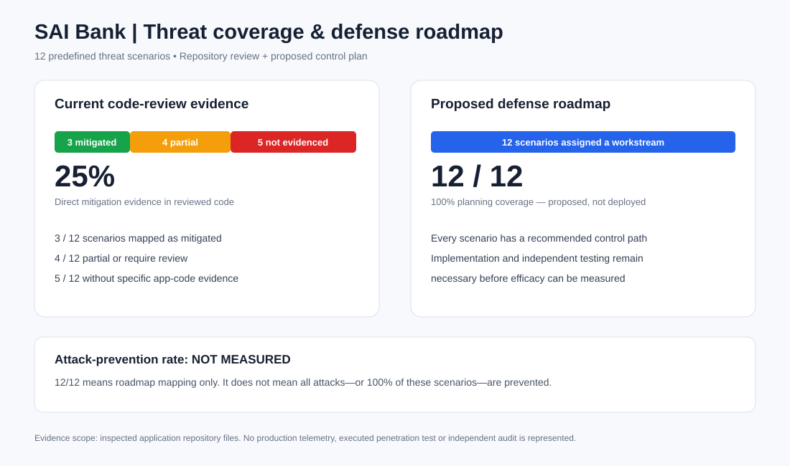
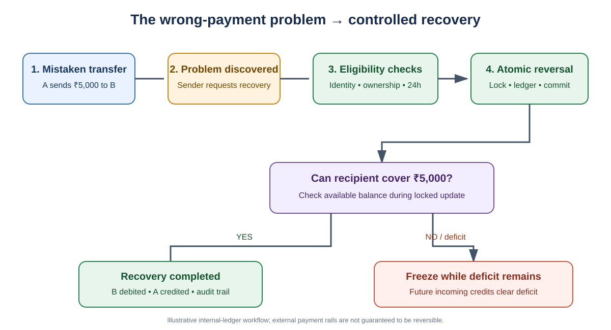
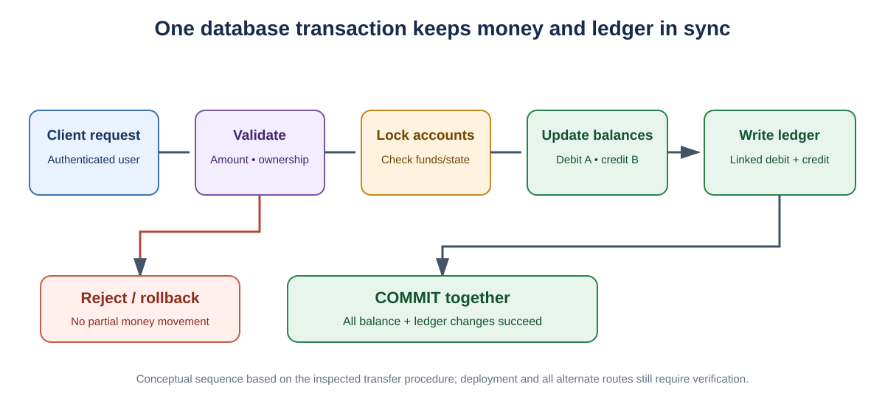
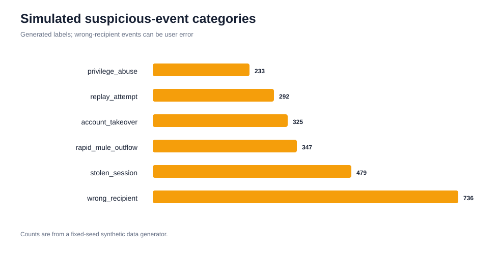
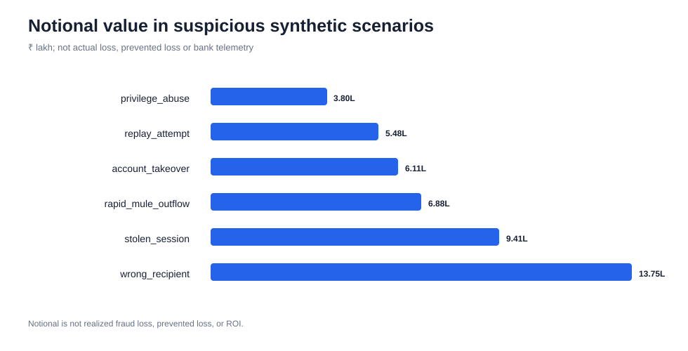
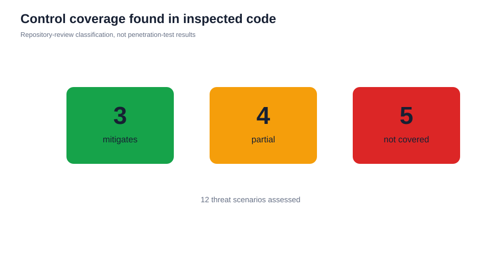
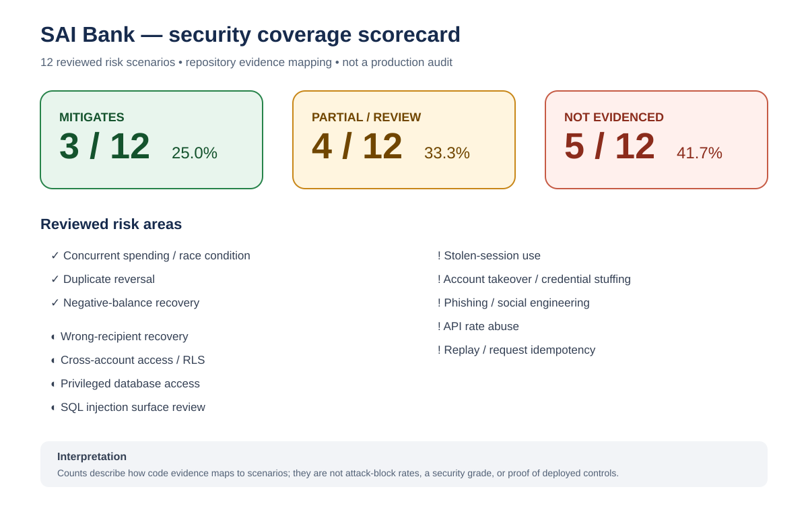
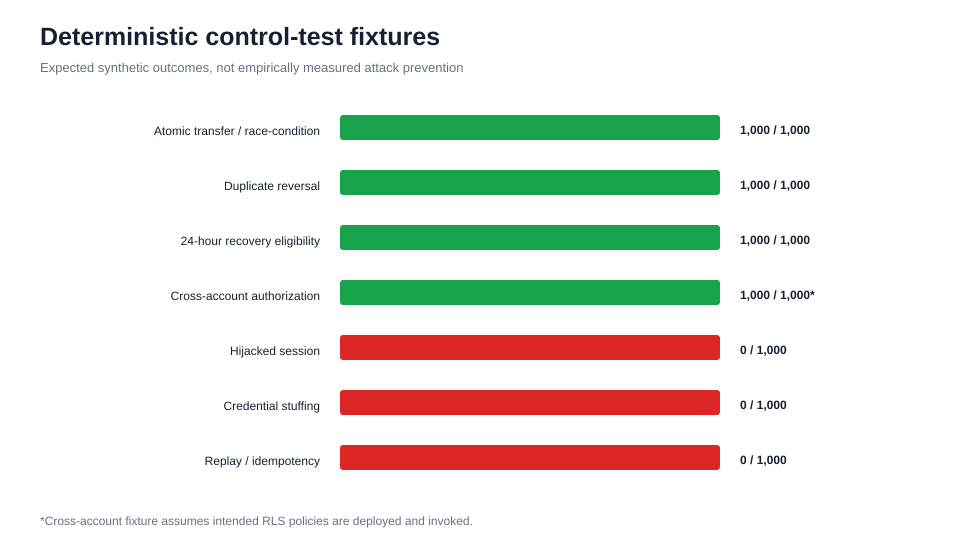

# SAI Bank Security Research Report
## Database-Level Transaction Integrity and 24-Hour Wrong-Payment Recovery

**Project:** [SAI Bank](https://github.com/pallasivasai/saibank)  
**Study type:** Repository-based design review + reproducible synthetic scenario analysis  
**Dataset seed:** `20261113`  
**Status:** Demonstration application; not production-certified

> **Research integrity statement:** This report distinguishes implementation evidence, synthetic experiment outputs, test-fixture assumptions and production outcomes. Synthetic statistics are not real bank telemetry, actual fraud, recovered money, prevented loss or measured product efficacy. No claim is made that SAI Bank prevents all cyberattacks.







---

## Executive summary

SAI Bank addresses a specific financial-technology problem: how to keep internal account balances and ledger entries consistent during transfers, and how to provide a controlled recovery path when an eligible customer reports a wrong payment within 24 hours.

The inspected code provides evidence of:
- Database-level transfer validation, account-row locking, balance updates and linked ledger entries.
- A 24-hour reversal procedure with caller, ownership, transaction-type and previous-reversal checks.
- Negative-balance handling that freezes an account while a recovery deficit remains, with future credits able to clear the deficit.
- Initial Row-Level Security (RLS) policies for selected data.

These controls support transaction integrity and customer remediation. They do not, by themselves, address the full threat landscape: phishing, malware, stolen credentials, account takeover, session hijacking, API abuse, insider threats, denial of service or operational compromise require additional controls.

### Research snapshot

| Evidence category | Current result | Correct interpretation |
|---|---:|---|
| Generated transfer records | 40,000 | Synthetic dataset size |
| Synthetic account identifiers | 2,500 | Fictional identifiers |
| Planted suspicious labels | 2,403 (6.01%) | Generator-selected labels, not observed attack rate |
| Notional value on labelled records | ₹43.93 lakh | Simulated transfer value, not loss |
| Risk scenarios reviewed | 12 | Repository review categories |
| Scenarios mapped as mitigated | 3 | Code evidence relevant to named scenarios |
| Partial / needs review | 4 | Some evidence, but further validation required |
| No specific control evidenced in inspected app code | 5 | Scoped code-review gap, not proof about every deployment layer |

---

## 1. Problem definition and business context

Digital payment systems must preserve three things at once:

1. **Balance integrity:** a transfer must not debit one account without correctly crediting the other.
2. **Ledger integrity:** every balance movement must have traceable, linked records.
3. **Customer remediation:** eligible mistaken transfers need a controlled recovery process that does not create unsupported funds or duplicate reversals.

### The concrete failure scenario

Customer A sends ₹5,000 to customer B by mistake. A notices two hours later. B may still have the funds—or may already have spent some or all of them.

A naive implementation that simply credits A can create an unbacked balance. A multi-step implementation can also fail halfway through, leaving account balances and ledger entries inconsistent.

**Research question:** Can database-level controls preserve internal ledger integrity while enabling a bounded, auditable wrong-payment recovery workflow?

## 2. SAI Bank product workflow



### Recovery sequence

1. A submits a recovery request within the configured 24-hour window.
2. The database procedure authenticates the caller and verifies transaction ownership.
3. It checks that the original transaction is an eligible debit and has not already been reversed.
4. Relevant account rows are locked before balance changes.
5. Compensating ledger entries are written and the original transaction is marked as reversed.
6. If the recipient cannot cover the debit, the recipient can enter a negative balance and be frozen; future incoming credits can clear the deficit.

**Important boundary:** the 24-hour period is a request window, not a guarantee that every transfer can be recovered. This describes the application's internal ledger. It cannot guarantee recovery from an external bank, UPI rail or payment provider.

## 3. Transaction integrity architecture



The inspected `transfer_money()` procedure authenticates and validates the request, locks account rows, updates balances and writes linked debit/credit ledger entries within one database function/transaction. The inspected `reverse_transaction()` procedure checks caller identity, ownership, transaction type, previous reversal and the 24-hour deadline before writing compensating entries under account locks.

### Why atomicity matters

If a sender debit, recipient credit and ledger writes are separate operations, a failure between steps can leave an inconsistent state. A single database transaction is designed to commit all related changes together or roll them back.

### Engineering caveat

The repository also contains a legacy Edge Function that appears to make balance and ledger changes as separate requests. If this route remains reachable, it should be retired or refactored to call the atomic database procedure. Protection depends on every money-changing path enforcing the same guarded logic.

## 4. Repository evidence review

Inspected implementation files:
- `drizzle/migrations/0000_transfer_and_24h_reversal_with_freeze.sql`
- `supabase/migrations/20251124144103_42d0ffa9-ef97-4422-863c-ed276f9c8fcb.sql`
- `supabase/functions/wrong-payment-reversal/index.ts` (legacy path)

| Risk / control objective | Evidence in inspected code | Assessment |
|---|---|---|
| Concurrent overspending | Account-row locks and balance validation in transfer procedure | Mitigates the named race scenario if all paths use it |
| Wrong-recipient payment | 24-hour recovery workflow and compensating entries | Customer-remediation path; not attack detection |
| Duplicate reversal | Reversal markers and previous-reversal checks | Relevant control; concurrent idempotency needs testing |
| Recipient already spent funds | Negative-balance freeze and future-credit clearing | Internal-ledger deficit handling; no external-rail guarantee |
| Cross-account data access | RLS and ownership checks | Partial; policies, grants and privileged functions need full audit |
| Hijacked session | No dedicated device/session-risk control evidenced | Gap in inspected application evidence |
| Account takeover | MFA/passkeys and anti-automation controls not evidenced | Gap in inspected application evidence |
| Phishing / social engineering | No scam intervention or beneficiary cooling-off evidenced | Gap in inspected application evidence |
| API rate abuse | Explicit rate limits not evidenced | Gap in inspected application evidence |
| Replay | Idempotency key not evidenced in inspected SQL | Gap in inspected application evidence |
| Privileged database access | `SECURITY DEFINER` functions exist; grants require review | Partial / review required |
| SQL injection surface | Main transfer function uses parameterized arguments | Partial; audit all query paths and exposed RPCs |

“Not evidenced” means not found in the inspected application files; it does not prove a control is absent from every hosting, identity or infrastructure layer.

## 5. Synthetic experiment design

The Python generator uses NumPy and pandas with a fixed seed (`20261113`). It creates 40,000 fictional transfers and 2,500 synthetic account identifiers, then plants labelled scenarios such as stolen sessions, account takeover, wrong recipient, rapid mule-style outflow, replay and privilege abuse.

### Dataset results

| Metric | Result | Interpretation |
|---|---:|---|
| Total transfers | 40,000 | Generated records |
| Normal-labelled transfers | 37,597 | Generator label |
| Suspicious-labelled transfers | 2,403 | Generator label; 6.01% in this generated sample |
| Notional on suspicious-labelled records | ₹43.93 lakh | Sum of simulated transfer amounts |
| Risk scenarios in control map | 12 | Repository-review categories |

The ₹43.93 lakh value is **not** confirmed fraud loss, actual customer exposure, recovered money, loss avoided or ROI. The generator's planted approximately 6.01% sample share is not an estimate of real-world fraud prevalence.

### Scenario distribution



### Simulated notional distribution



## 6. Advanced statistical analysis


The reproducible statistical appendix reports transaction percentiles (P50/P90/P95/P99), mean and median values, a Wilson interval for the generated-label share, monthly variability, suspicious-label composition and sender-notional concentration (HHI). These are descriptive statistics for the seeded synthetic sample only. The interval is not a real-world fraud-prevalence interval, and HHI is not a fraud score.

See the [full statistical appendix](STATISTICAL_APPENDIX.md) for definitions, exact values, caveats and reproduction steps.

## 7. Control coverage analysis





The repository review maps 12 named scenarios into three evidence classes:

| Classification | Count | Share of reviewed scenarios |
|---|---:|---:|
| Mitigates | 3 | 25.0% |
| Partial / review required | 4 | 33.3% |
| No specific control evidenced in inspected app code | 5 | 41.7% |

These are **scenario classifications**, not an overall security score, a percentage of attacks stopped, or a production efficacy measurement. A “mitigates” mapping applies only to the stated scenario and assumptions.

## 8. Defense-in-depth: current evidence vs planned coverage


The review currently finds direct mitigation evidence for **3/12 scenarios (25.0%)**, partial evidence for **4/12 (33.3%)**, and no specific control in the inspected app code for **5/12 (41.7%)**. The new roadmap maps a proposed control and validation workstream to **12/12 scenarios (100% planning coverage)**. This is a planning-completeness measure—not a prevention rate, implementation status or proof that most cyberattacks are stopped.

The [Threat Coverage Roadmap](THREAT_COVERAGE_ROADMAP.md) lists each scenario, existing evidence, proposed controls and required verification. Broad protection claims must wait until those controls are implemented, tested and independently assessed.

## 9. Test evidence: what is and is not measured

The current `synthetic_control_tests.csv` contains seven deterministic fixture rows, each describing 1,000 hypothetical attempts. Four rows assume a control rejects the named scenario; three rows represent controls not evidenced in inspected code.



These rows are **test-fixture assumptions**, not 7,000 live requests, executed penetration tests, or measured production pass rates. They must not be reported as “100% attack prevention.”

### Required executable test programme

| Test family | Minimum evidence to collect | Success criterion |
|---|---|---|
| Concurrent transfers | Parallel requests, before/after balances, ledger rows | No overspend; balances reconcile |
| Duplicate recovery | Concurrent repeated reversal requests | Exactly one effective reversal |
| Recovery window | Boundary tests before, at and after 24 hours | Eligibility matches documented rule |
| Authorization | Cross-user read/write and RPC attempts | Unauthorized operations denied |
| Negative-balance freeze | Recovery when recipient has insufficient funds | Freeze remains until deficit cleared |
| Replay/idempotency | Re-submit same request and idempotency key | No duplicate money movement |
| Authentication/session | Stolen/expired/revoked session test cases | Invalid or risky sessions rejected |
| API abuse | Rate-limit and burst tests | Limits enforced and logged |

No pass rates should be published until these tests are implemented, executed against a controlled environment, and their raw outputs are retained.

## 10. Security coverage roadmap

| Priority | Workstream | Why it matters | Verification evidence |
|---|---|---|---|
| P0 | Retire legacy multi-request money-movement path | Avoid split balance and ledger changes | Deployed-route review and integration tests |
| P0 | Audit RLS, grants, `SECURITY DEFINER`, ownership and execute permissions | Reduce unauthorized access and privilege misuse | SQL privilege audit and negative authorization tests |
| P0 | Deterministic lock ordering, deadlock retry and idempotency | Safer concurrency and request retries | Parallel opposing transfers and replay tests |
| P1 | MFA/passkeys and step-up checks for risky transfers | Reduce account-takeover impact | Authentication journey tests |
| P1 | Rate limits and bot controls | Reduce credential stuffing and automated API abuse | Abuse/load tests |
| P1 | Device/session anomaly signals, alerts and revocation | Improve detection and containment | Session-risk simulations |
| P1 | Scam warnings and beneficiary cooling-off | Reduce social-engineering impact | Controlled customer journey tests |
| P2 | Tamper-resistant audit stream and centralized alerts | Improve investigation and response | Alert, retention and tamper tests |
| P2 | Independent threat model and penetration test | Validate assumptions beyond code review | External assessment and remediation retest |

## 11. Business impact measurement plan

The current synthetic dataset cannot establish real money saved or customer outcomes. Once instrumented in a controlled pilot, measure:

- Eligible recovery requests and completion time.
- Recovered amount, outstanding deficit and unrecovered amount.
- Duplicate/replayed requests rejected.
- Ledger reconciliation exceptions.
- Fraud alerts reviewed and confirmed outcomes.
- Support handling time and customer resolution time.
- False-positive rate and customer friction.
- Operating cost per reviewed incident.

Report numerator, denominator, measurement period, source system and exclusions for every KPI. Do not label transaction notional as loss prevented.

## 12. Limitations and responsible interpretation

- SAI Bank is a demonstration app, not a production-readiness certification.
- Repository inspection does not prove which code paths are deployed or reachable.
- Synthetic data has planted labels and simplified behaviour; it cannot estimate real fraud prevalence.
- Control mappings are qualitative code-review judgments.
- Fixture rows are not executed security-test results.
- No live attack simulation, independent penetration test, database execution test or production efficacy study was performed.
- Internal-ledger recovery cannot guarantee funds can be retrieved from external banks or payment rails.
- Comprehensive cyber defence requires identity, application, infrastructure, people and operational controls.

## 13. Reproducibility

From the repository root:

```bash
python -m pip install -r case-studies/sai-bank-security/requirements.txt
python case-studies/sai-bank-security/src/generate_data.py
python case-studies/sai-bank-security/src/analyze.py
python case-studies/sai-bank-security/src/advanced_analysis.py
python case-studies/sai-bank-security/src/render_svg_charts.py
```

The fixed seed makes the generated dataset reproducible. `advanced_analysis.py` exports `advanced_metrics.json`, monthly statistics and scenario-level statistics. Reproducibility does not convert synthetic data into real-world evidence.

## 14. References and project links

- [SAI Bank source repository](https://github.com/pallasivasai/saibank)
- [SAI Bank demo](https://saibank.lovable.app/)
- [Companion analytics repository](https://github.com/pallasivasai/docs_)
- [Threat coverage roadmap](THREAT_COVERAGE_ROADMAP.md)
- [Generated chart assets](images/)

**Conclusion:** SAI Bank demonstrates useful database-level patterns for safer internal transfers and a bounded wrong-payment recovery workflow. It is a credible foundation for further fintech security engineering, but broader protection requires the roadmap above and independent validation. The defensible claim is specific risk reduction supported by evidence—not elimination of all cyber issues.
